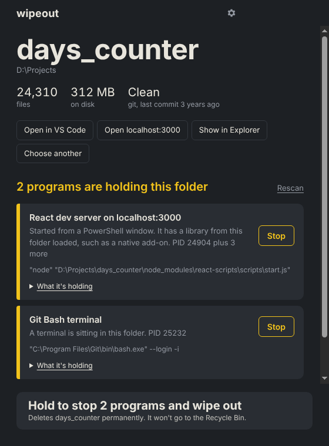
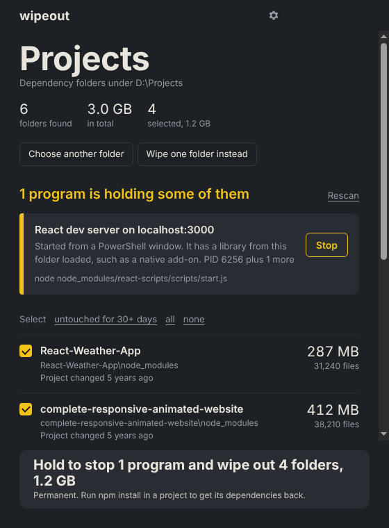

# Wipeout: delete locked folders on Windows

**Delete folders Windows won't let you delete.** Wipeout shows which program is holding a folder (the forgotten `npm start`, a terminal sitting in it, VS Code, Explorer), stops it with one click, and deletes the folder fast, including `node_modules` folders with 100,000 files and paths longer than 260 characters.



Free and open source, for Windows 10 and 11.

## Fixes these errors

If you've searched for any of these, this is the tool:

- *The action can't be completed because the folder or a file in it is open in another program*
- *Folder In Use* / *File In Use*
- `EBUSY: resource busy or locked, rmdir 'node_modules'`
- `EPERM: operation not permitted, unlink` when deleting or reinstalling `node_modules`
- *Source Path Too Long* / *The file name is too long* when deleting `node_modules`
- `rm -rf node_modules` that hangs or fails on Windows

## What it does

- **Names what's holding the folder in plain words.** It doesn't just say `node.exe PID 14352`. It says "React dev server on localhost:3000, started from a PowerShell window", or "Git Bash terminal: a terminal is sitting in this folder". Expand **What it's holding** to see the exact files.
- **Finds locks other tools miss.** It checks every open file handle on the system, programs running from inside the folder, and DLLs or native `.node` add-ons loaded from it, which never show up as open files.
- **Stops the whole chain at once.** One click stops terminal → npm → node together. It never takes VS Code, Explorer or your browser down with it, and it never stops parts of Windows itself.
- **Deletes fast and safely.** Deletion runs in parallel with a live progress bar and ETA. It handles read-only files and paths over 260 characters. It never follows a junction or symlink out of the folder: drop a link, and only the link is removed.
- **Cleans old node_modules in bulk.** Pick a projects folder. Wipeout lists every `node_modules` (and Rust `target`) with its size and how long since you touched the project, and pre-selects the ones idle for 30+ days. Then it wipes them. Batch mode deletes only folders named `node_modules` or `target`.
- **Warns before you lose work.** For git repos it shows uncommitted changes, unpushed commits, or "no remote: this repo exists only here".
- **Hold to wipe.** There's no "Are you sure?" dialog to click through on autopilot; you press and hold for a second.
- **Won't touch dangerous folders:** whole drives, Windows, Program Files, your user folder and its main folders, or Wipeout's own folder.
- **Right-click any folder → Wipe out** (on Windows 11, under *Show more options*). You can turn this off in settings.



## Wipeout Lite (no window)

If you only want the right-click entry, use **Wipeout Lite**: one 70 KB `.exe`, no app window, nothing running in the background.

1. Double-click `wipeout-lite.exe` and choose **Yes**. It copies itself to `%LOCALAPPDATA%\Programs\Wipeout Lite` and adds **Delete with Wipeout** to the folder right-click menu (for your user only, no admin).
2. Right-click a folder → **Delete with Wipeout**. On Windows 11 it's under *Show more options*, or hold **Shift** while you right-click.
3. One prompt lists anything using the folder (a dev server, a terminal, a program running from it). Choose **Yes** and Wipeout stops them and deletes the folder permanently. When it works, the folder just disappears.

It never stops Windows processes, and it won't stop editors, browsers or terminal windows, because that would close every window they have open. It tells you to close the folder there instead. Links (junctions) inside the folder are removed without touching what they point to. Drives, Windows and program folders, and your user folders are refused. If something needs admin rights, it offers to try again as administrator.

Remove it from **Settings → Apps → Wipeout Lite**, or double-click the installed `.exe` again. Build it with `npm run build:helper` (output: `lite/wipeout-lite.exe`); `npm run test:lite` tests it against real locked folders on Windows.

## Download

Get the installer or the portable `.exe` from [Releases](https://github.com/Shahryartariq/wipeout-dev/releases). The installer keeps itself up to date.

Windows SmartScreen may warn "Windows protected your PC" because the app isn't code-signed yet. Choose **More info → Run anyway**.

## Build from source

Needs Node.js 20 or newer.

```powershell
git clone https://github.com/Shahryartariq/wipeout-dev.git
cd wipeout-dev
npm install
npm start
```

| Command | What it does |
| --- | --- |
| `npm start` | Run the app |
| `npm test` | Delete-engine, process-naming and scanner-output tests |
| `npm run test:windows` | Lock scanner against real processes (Windows only) |
| `npm run test:lite` | Wipeout Lite against real locked folders (Windows only) |
| `npm run e2e` | Drives the real app through every flow |
| `npm run lint` | ESLint |
| `npm run bench` | Delete speed vs `rmdir /s /q` |
| `npm run build:helper` | Rebuild `resources/wipeout-locks.exe` and `lite/wipeout-lite.exe` |
| `npm run dist` | Build the installer and portable `.exe` into `dist/` |

To release, bump `version` in `package.json` and push a tag like `v1.0.1`. GitHub Actions builds both `.exe` files, attaches them to a draft release, and installed copies update once you publish it.

## How the lock scan works

`resources/wipeout-locks.exe` is a small C# program (source in `scripts/`) built with the C# compiler that ships with Windows. It does this:

1. Reads the system handle table (`NtQuerySystemInformation`) and keeps only file handles.
2. Duplicates each handle and asks Windows where it points (`GetFinalPathNameByHandle`). A watchdog thread skips any handle that hangs, such as a synchronous pipe.
3. Lists each process's loaded modules (`EnumProcessModulesEx`) to catch DLLs and native add-ons.
4. Adds each process's command line, parent and listening ports, so the app can say "Vite dev server on localhost:5173".

If the helper can't run, Wipeout falls back to `scripts/find-locks.ps1`, which compiles the same C# in memory through PowerShell.

**Limits:**
- Without administrator rights, handles held by elevated programs are invisible. Use *Restart as administrator* in the app.
- Locks held inside the kernel (some antivirus and backup drivers) can't be attributed to a process. Wipeout tells you to wait and rescan.

## Privacy

Wipeout works offline. It sends nothing anywhere; the only network call is the update check against this repo's GitHub Releases. Logs stay on your PC in `%APPDATA%\Wipeout\logs` (settings → *Open log folder*).

## Project layout

```
src/main.js              window, IPC, jobs, updates, crash logging
src/system.js            lock scan, stopping programs, git, open-with, right-click menu, admin
src/wipe-core.js         parallel scan / delete / batch engine
src/delete-worker.js     runs the engine in an Electron utility process
src/log.js               rotating log file
src/preload.js           the small, typed bridge the UI may use
src/renderer/            UI: app.js, batch.js, locks-logic.js (naming and grouping)
scripts/                 C# lock scanner, PowerShell fallback, helper build script
resources/               the compiled wipeout-locks.exe
lite/WipeoutLite.cs      Wipeout Lite: right-click delete with no window
test/                    unit, Windows integration, end-to-end and benchmark
build/installer.nsh      installer: right-click entry on install, cleanup on uninstall
```

## License

[MIT](LICENSE)
